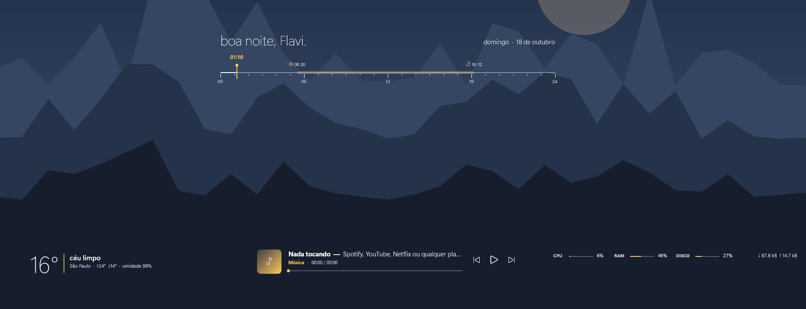
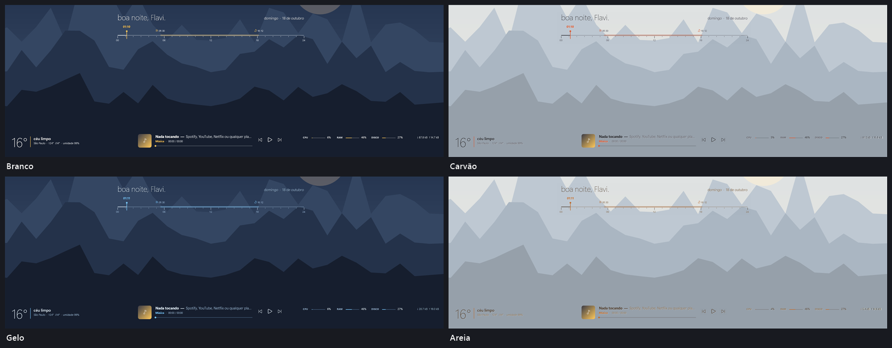
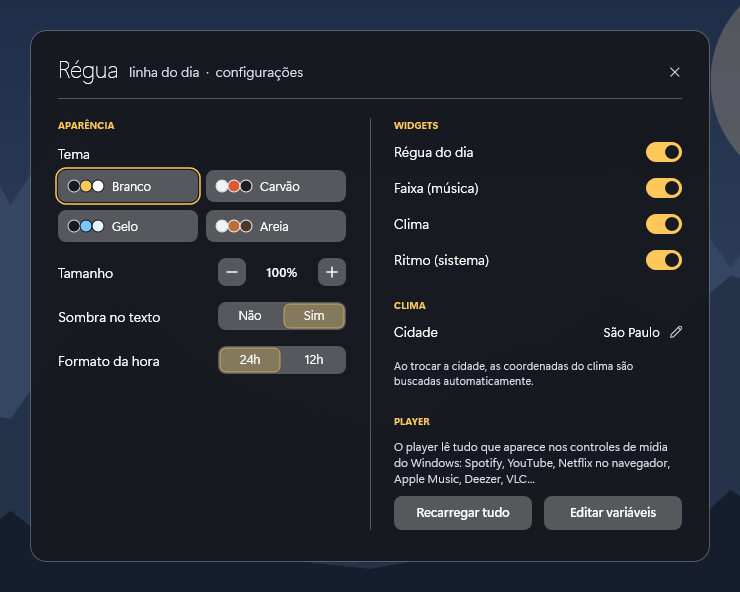

# Régua

**A linha do dia: régua de 24h com o agora, nascer e pôr do sol.**

Skin para o [Rainmeter](https://www.rainmeter.net), minimalista e com tela de configurações própria.

[**⬇ Baixar Regua.rmskin**](https://github.com/flavioferr/rainmeter-regua/releases/latest/download/Regua.rmskin)

## Sobre

A Régua mostra o dia como uma linha: uma régua de 24 horas com o marcador de agora e uma faixa de luz entre o nascer e o pôr do sol, mais saudação e data. Sem fundo, direto sobre o papel de parede, com um player em faixa fina.

## Widgets

| Widget | O que mostra |
|---|---|
| **Régua do dia** | régua de 24h, marcador de agora, faixa de luz do dia, saudação e data |
| **Faixa** | player fino: capa, faixa — artista, fonte, tempo, progresso clicável e controles |
| **Clima** | temperatura grande, condição, máxima, mínima e umidade |
| **Ritmo** | CPU, RAM, disco e rede numa linha |

## Temas

4 temas prontos: Branco, Carvão, Gelo, Areia.

## Configurações

Clique com o botão direito em qualquer widget → **Configurações**. Tudo é salvo na hora.

- Tema (4 opções)
- Tamanho dos widgets (70% a 160%)
- Sombra no texto
- Hora em 24h ou 12h
- Sua cidade (coordenadas buscadas automaticamente)
- Ligar/desligar cada widget

## Instalação

1. Instale o [Rainmeter](https://www.rainmeter.net) (4.5 ou mais novo).
2. Baixe o [`Regua.rmskin`](https://github.com/flavioferr/rainmeter-regua/releases/latest) na página de Releases.
3. Dê dois cliques no arquivo e clique em **Install**.
4. Na primeira vez, os widgets aparecem já posicionados e as configurações abrem sozinhas.

Prefira o `.rmskin`: ele já instala o plugin de música. A pasta [`Regua`](Regua) tem o código da skin.

## Dicas

- **Música:** o player lê tudo que aparece nos controles de mídia do Windows — Spotify, YouTube, Netflix e qualquer site no Chrome/Edge/Firefox, Apple Music, Deezer, VLC… O plugin [WebNowPlaying](https://github.com/keifufu/WebNowPlaying-Rainmeter) (MIT) já vem dentro do `.rmskin`; a [extensão do navegador](https://wnp.keifufu.dev) é opcional. Clique na barra de progresso para pular.
- **Clima:** digite sua cidade nas configurações; as coordenadas são buscadas sozinhas (se não encontrar, tente sem acento). Os dados vêm do [Open-Meteo](https://open-meteo.com), gratuito e sem chave de API.
- **Mover:** arraste os widgets com o mouse.
- **Ajustes avançados:** o botão *Editar variáveis* abre o `@Resources/Variables.inc`.

## Requisitos

Windows 10 ou 11 e Rainmeter 4.5+. As fontes usadas já vêm com o Windows 11. Se o player ficar vazio, instale o [Microsoft Visual C++ Redistributable](https://aka.ms/vs/17/release/vc_redist.x64.exe), usado pelo plugin de música.

## Coleção

Outras skins da mesma leva:

- [Divisa](https://github.com/flavioferr/rainmeter-divisa) — Horas gigantes de um lado, música, clima e frase do dia do outro.
- [Serra](https://github.com/flavioferr/rainmeter-serra) — Vidro fosco: barra de menu, central de controle, widgets e dock.
- [Mosaico](https://github.com/flavioferr/rainmeter-mosaico) — Um kit de 9 cartões: relógio, lembretes, cronômetro, música, previsão e mais.
- [Painel](https://github.com/flavioferr/rainmeter-painel) — Blocos escuros com destaque colorido: nota, busca, visualizador, links e player.
- [Eixo](https://github.com/flavioferr/rainmeter-eixo) — Um eixo central minimalista: saudação, dia da semana gigante, data e hora.
- [Maré](https://github.com/flavioferr/rainmeter-mare) — Vidro e música: a capa do que está tocando vira o cartão.
- [Bússola](https://github.com/flavioferr/rainmeter-bussola) — Tudo em círculos: relógio em anel, disco que gira e medidores.
- [Lousa](https://github.com/flavioferr/rainmeter-lousa) — Escrito à mão: lista do dia, recado adesivo e um player de fita cassete.
- [Console](https://github.com/flavioferr/rainmeter-console) — Terminal: fetch do sistema, prompt de busca, todo.txt e player em ASCII.

E mais 12 na coleção: [Lumen](https://github.com/flavioferr/rainmeter-lumen), [Horizon](https://github.com/flavioferr/rainmeter-horizon), [Orbit](https://github.com/flavioferr/rainmeter-orbit), [Shell](https://github.com/flavioferr/rainmeter-shell), [Folio](https://github.com/flavioferr/rainmeter-folio), [Bento](https://github.com/flavioferr/rainmeter-bento), [Prisma](https://github.com/flavioferr/rainmeter-prisma), [Linea](https://github.com/flavioferr/rainmeter-linea), [Pixel](https://github.com/flavioferr/rainmeter-pixel), [Soft](https://github.com/flavioferr/rainmeter-soft), [Swiss](https://github.com/flavioferr/rainmeter-swiss) e [Island](https://github.com/flavioferr/rainmeter-island).

## Licença

[CC BY-NC-SA 4.0](LICENSE.md) — use, modifique e compartilhe, dando crédito e sem fins comerciais.
O plugin WebNowPlaying incluído no `.rmskin` é de [keifufu](https://github.com/keifufu/WebNowPlaying-Rainmeter), sob licença MIT.
